# Roadmap: Composable Pipeline & Chained Strategy Architecture

## 1. Executive Summary & Problem Diagnosis

Currently, strategy and backtesting scripts in `honba-examples` bundle universe selection, indicator computation, entry/exit signals, capital allocation, and execution inside monolithic classes or one-off scripts. 

### Current Pain Points:
1. **Monolithic Coupling**: A strategy class in `strategies/` hardcodes its indicators, sizing logic, and execution rules together. You cannot take a screener's output (e.g. Stage 2 multibagger or 52-week low value stock) and pipe it into a position sizer or SIP execution model without copy-pasting code.
2. **Missing CLI Interoperability**: Scripts produce human-readable tables by default, making stdout piping into downstream tools difficult unless custom format flags are added ad-hoc.
3. **No Standardized Data Flow**: There is no universal pipeline contract between:
   $$\text{Universe / Screener} \longrightarrow \text{Quality / Regime Filter} \longrightarrow \text{Signal / Timing} \longrightarrow \text{Sizing / Allocation} \longrightarrow \text{Execution / Backtester}$$

---

## 2. The Solution: Dual-Plane Chaining Architecture

We structure chaining across **two complementary planes**:

```mermaid
flowchart TD
    subgraph PlaneA ["Plane A: Unix CLI Stream Chaining (Terminal / Shell)"]
        S1["08_screener_multibagger.py<br/>--format symbols / json"] -->|stdout | F1["11_filter_fundamentals.py<br/>--min-roce 15 --max-de 1.0"]
        S2["10_screener_value_dividend.py<br/>--near-52w-low --min-div 3.0"] -->|stdout | F1
        F1 -->|stdout | B1["09_backtest_sip.py<br/>--sip-amount 10000 --asof 2023-01-01"]
        F1 -->|stdout | B2["12_backtest_rebalance.py<br/>--freq monthly --equal-weight"]
    end

    subgraph PlaneB ["Plane B: Python Object Pipeline Chaining (In-Code DSL)"]
        US["Universe / Screener<br/>Multibagger / Value 52w Low"] --> QF["Quality Filter<br/>ROCE / Debt-to-Equity / FCF"]
        QF --> MR["Market Regime Guard<br/>Nifty > 200 SMA"]
        MR --> SG["Signal Generator<br/>Breakout / Pullback / SIP"]
        SG --> PS["Position Sizer<br/>Equal / Volatility / Fixed SIP"]
        PS --> RM["Risk Manager<br/>Trailing Stop / Drawdown Guard"]
        RM --> EX["Execution Harness<br/>Backtest / Paper / Live"]
    end
```



---

## 3. Composable Strategy Components (Pipeline Taxonomy)

Every strategy phase adheres to a lightweight, typed interface:

### 1. Screeners (`honba_examples.pipeline.screeners`)
*Input: Catalog path, evaluation date `--asof` $\rightarrow$ Output: Ranked candidates with point-in-time metrics.*
- `MultibaggerScreener`: Stage 2 Momentum (1y return $>35\%$, Price $> \text{SMA}_{200}$ rising, within $20\%$ of 52w High).
- `ValueScreener`: Deep value (P/E $< 20$, P/B $< 2.0$, trading within $10\%$ of 52-week Low).
- `DividendYieldScreener`: High dividend yielders ($\ge 3.0\%$ cash dividend yield, positive FCF, within $15\%$ of 52-week Low).

### 2. Quality & Regime Filters (`honba_examples.pipeline.filters`)
*Input: Candidates list $\rightarrow$ Output: Filtered candidates.*
- `FundamentalQualityFilter`: Filters by ROCE $\ge 15\%$, Debt/Equity $\le 1.0$, Operating Margin $> 0\%$.
- `MarketRegimeFilter`: Checks benchmark index (e.g. `NIFTY 50` trading above its 200-day SMA); inhibits new buys in bear regimes.
- `LiquidityFilter`: Filters out symbols with average daily turnover below a threshold (e.g. ₹5 Cr/day).

### 3. Sizing & Allocation (`honba_examples.pipeline.sizing`)
*Input: Qualified symbols $\rightarrow$ Output: Target capital/weights per asset.*
- `FixedSipSizer`: ₹10,000/month per stock systematic investment.
- `EqualWeightSizer`: $1/N$ capital rebalancing allocation.
- `InverseVolatilitySizer`: Allocates inversely proportional to 30-day realized volatility or ATR.

### 4. Execution & Backtesting (`honba_examples.pipeline.execution`)
*Input: Sized orders $\rightarrow$ Output: Trade journal, portfolio curve, PnL, XIRR.*
- `SipBacktestHarness`: Monthly/weekly rupee cost averaging simulation, terminal valuation, XIRR.
- `RebalanceBacktestHarness`: Periodic rebalance with Indian tax/cost model and drift threshold.
- `EventDrivenHarness`: Intraday/daily bar-by-bar event execution with T+1 settlement and next-open fills.

---

## 4. Proposed Repository Re-structuring

### Directory Layout for `honba-examples/`

```
honba-examples/
├── honba_examples/
│   ├── pipeline/                     # Composable Pipeline Framework
│   │   ├── __init__.py
│   │   ├── base.py                   # Pipeline, Step, PipeMixin (operator >> or |)
│   │   ├── screeners.py              # Screener protocols and shared price/DuckDB readers
│   │   ├── filters.py                # Fundamental & regime filters
│   │   ├── signals.py                # Timing signals (breakout, pullback, buy-and-hold)
│   │   ├── sizing.py                 # Sizing strategies (SIP, EqualWeight, Volatility)
│   │   └── io.py                     # Stream reader/writer (stdin/stdout JSON & symbols)
│   ├── catalog.py
│   ├── metrics.py                    # XIRR, CAGR, MaxDD, Sharpe
│   └── output.py
│
├── screening/                        # Dedicated Screener Tools (Each does one thing)
│   ├── 01_multibagger_screener.py    # Stage 2 momentum screener as of --asof
│   ├── 02_value_52w_low_screener.py  # Deep value & 52-week low screener as of --asof
│   ├── 03_dividend_yield_screener.py # High dividend yielders at 52-week low with strong ROCE
│   └── README.md
│
├── backtesting/                      # Composable Backtest Engines
│   ├── 01_first_backtest.py          # Minimal SMA crossover
│   ├── ...
│   ├── 08_sip_buy_and_hold.py        # Single-instrument SIP buy-and-hold
│   ├── 09_forward_sip_backtest.py    # General forward monthly SIP backtester (reads stdin pipe or --symbols)
│   ├── 11_portfolio_rebalancer.py    # Forward equal-weight rebalancing backtester
│   └── README.md
│
└── strategies/                       # Modular Chained Strategy Recipes
    ├── 01_pipeline_intro.py          # Minimal A >> B >> C pipeline demonstration
    ├── 02_multibagger_momentum.py    # Multibagger Screener >> Quality Filter >> SIP Backtest
    ├── 03_dogs_of_nifty.py           # High Dividend 52w Low >> ROCE Filter >> Equal Weight Rebalance
    ├── 04_contrarian_value.py        # 52w Low >> Low P/E >> ATR Trailing Stop
    └── README.md
```

---

## 5. End-to-End Chaining Examples

### CLI Chaining Examples (Unix Streams)

#### 1. Multibagger Momentum $\rightarrow$ Forward SIP
```bash
# Screen top 5 multibaggers as of 2023-01-01 and pipe directly into the forward SIP backtester
python screening/01_multibagger_screener.py --asof 2023-01-01 --top 5 --format symbols \
  | python backtesting/09_forward_sip_backtest.py --asof 2023-01-01 --sip-amount 10000
```

#### 2. Dogs of the NSE (High Dividend Yielders at 52-Week Low) $\rightarrow$ Forward SIP
```bash
# Screen stocks within 10% of 52-week low, min 3.0% dividend yield, ROCE >= 12%
python screening/03_dividend_yield_screener.py --asof 2023-01-01 --min-div-yield 3.0 --max-pct-from-52w-low 10.0 --format symbols \
  | python backtesting/09_forward_sip_backtest.py --asof 2023-01-01 --sip-amount 10000
```

#### 3. Deep Value at 52-Week Low with Strong Balance Sheets $\rightarrow$ Forward SIP
```bash
# Screen stocks at 52-week low with P/E < 20 and Debt/Equity < 1.0
python screening/02_value_52w_low_screener.py --asof 2023-01-01 --max-pe 20 --max-debt-equity 1.0 --format symbols \
  | python backtesting/09_forward_sip_backtest.py --asof 2023-01-01
```

### Python In-Code Chaining DSL

```python
from honba_examples.pipeline import (
    Pipeline,
    DividendYieldScreener,
    FundamentalQualityFilter,
    MarketRegimeFilter,
    FixedSipSizer,
    SipBacktestHarness,
)

# Compose the entire strategy with overloaded '|' or '>>' operator:
pipeline = (
    DividendYieldScreener(min_yield_pct=3.0, max_pct_from_52w_low=10.0)
    >> FundamentalQualityFilter(min_roce=15.0, max_debt_to_equity=1.0)
    >> MarketRegimeFilter(benchmark="NIFTY", condition="above_sma200")
    >> FixedSipSizer(monthly_amount=10000.0)
    >> SipBacktestHarness(asof="2023-01-01")
)

results = pipeline.run()
results.print_summary()
```

---

## 6. Implementation Phases

| Phase | Milestone | Deliverables |
|:---|:---|:---|
| **Phase 1** | **Standardize CLI I/O Stream Contract** | Ensure all screeners support pure symbol/JSON streams on `stdout` and diagnostic logs on `stderr`. Update backtester to ingest stdin pipes automatically. |
| **Phase 2** | **Add Value & Dividend 52w-Low Screeners** | Implement `02_value_52w_low_screener.py` and `03_dividend_yield_screener.py` using DuckDB fundamentals and 1D Parquet catalog with point-in-time rules (fundamentals by period end plus a lag proxy). |
| **Phase 3** | **Core Pipeline Abstraction (`honba_examples.pipeline`)** | Implement `Step`, `Pipeline`, and operator overloads (`>>`) for Python in-code composition. |
| **Phase 4** | **Restructure & Document Example Recipes** | Organize into `screening/`, `strategies/`, and `backtesting/` directories with full integration test coverage. |
| **Phase 5** | **Manifests and chains** | `describe()` step manifests, `report=[...]` columns and the TOML chain runner (`pipeline/chain.py`, `screening/06_run_chain.py`); see below. |

---

## 7. Phase 5: manifests and chains

Goal: a GUI algo designer (later) can list steps, render their params, check that a chain is
compatible and show a user-chosen set of columns, all from data, without importing Python.

**Stage semantics (canonical, shared with honba-strategies' `schema/README.md`)**

```
universe --screen--> candidates --filter--> candidates --size--> weights --execute--> orders / result
```

- `screen` consumes a `universe` (or `none`) and emits `candidates`; `filter` maps `candidates` to
  `candidates`; `size` maps `candidates` to `weights` (it does not trade); `signal` is per-symbol
  timing, `universe -> orders`, for single-instrument bar strategies.
- `execute` consumes `weights` **or** `universe` and emits orders or a result. Given `weights` it
  executes them (`execute.sip_backtest`); given a `universe` it is a self-contained portfolio
  strategy that selects, weights and schedules itself (the six `portfolio/` and `universe/alpha/`
  catalog strategies are `execute.*`, not sizers).
- `consumes.shape` is a string or a list of accepted shapes. Kind order is
  screen, filter, signal, size, risk, execute. `signal` and `size` are both optional, but a chain is
  either screen/filter/size/execute (portfolio) or a lone signal/execute: a signal already emits
  orders, so `signal -> size` is rejected.
- Catalog ids (`signal.*`, `execute.*` from honba-strategies) validate in a chain, so a GUI can
  check `screen -> filter -> size -> execute.equal_weight`. The pipeline only runs its own steps;
  `run_chain` raises `ChainNotRunnableError` ("validated but not runnable in this pipeline yet") for
  catalog ids. Running them would need a backtest-engine bridge, which is future work.

**Implemented**

- Every step except the signal stubs has `describe()`: a dict in the shape of honba-strategies'
  `step.toml` (`schema/step.schema.json`): id, kind, params with types/defaults/bounds,
  `requires` (what it looks at), `consumes`, and `emits` with `adds`, `report` and `reportable`.
  Tests validate each against the catalog schema and check params against constructor defaults.
- `report=[...]` on the three screeners and `FundamentalQualityFilter` appends columns the step
  does not filter on (`market_cap`, `dividend_yield_pct`, `pe_ratio`, `pb_ratio`, `roce_pct`,
  `roe_pct`, `debt_to_equity`, `operating_margin_pct`, `net_margin_pct`, `free_cash_flow`,
  `eps`). They are derived point-in-time from `fundamentals.duckdb`; an unknown column raises
  an error listing the reportable ones, and a symbol with no data gets `None`.
- `pipeline/chain.py`: `load_chain` (TOML `[[steps]] uses / with / report`), `REGISTRY`,
  `validate` (unknown ids plus honba-strategies' `validate_chain`), `build_pipeline`, `run_chain`.
- `screening/06_run_chain.py` (`--chain`, `--validate-only`, `--describe`, `--format`, `--out`)
  and `screening/chains/quality_value.toml`.

**Not implemented (future)**

- Manifests and registry entries for the Graham and net-net screeners (they are scripts, not
  steps) and for the timing signals (stubs).
- Reporting on the regime, liquidity and sizing steps; reporting technical columns such as an
  EMA200 or a 52-week high on a step that does not compute them.
- Reporting a column the fundamentals store cannot supply (for example EV/EBITDA or a revenue
  growth rate); these raise an error rather than guessing.
- Free-form candidate weights (`FixedSipSizer(weights=...)`) and `catalog_dir` are not exposed
  as manifest params.
- The GUI itself, and publishing these manifests as `step.toml` files in honba-strategies.
